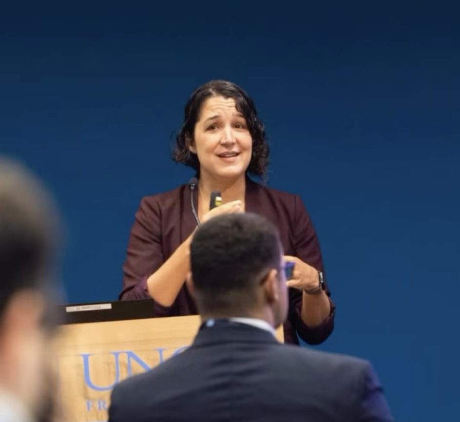

I was invited to be an "Honored Alumni Speaker" at the [51st Annual Lineberger Trainee Research Day.](https://unclineberger.org/event/51st-annual-unc-lineberger-comprehensive-cancer-center-trainee-research-day/) This event, coordinated by the UNC Lineberger Cancer Research Training and Education Coordination program (CRTEC), unites pre- and post-doctoral students in cancer-related T-32 training programs across UNC. In addition to meeting so many wonderful students and postdocs and attending fascinating talks by trainees across disciplines, I gave a talk entitiled "From T32 to Tenure-Track" about my career path and lessons learned as an early career researcher. It was a delight to return to UNC campus and to connect with new and old friends and collaborators at Lineberger! 

<!--more-->

I look very distressed in this photo but I promise I was having a great time! 

